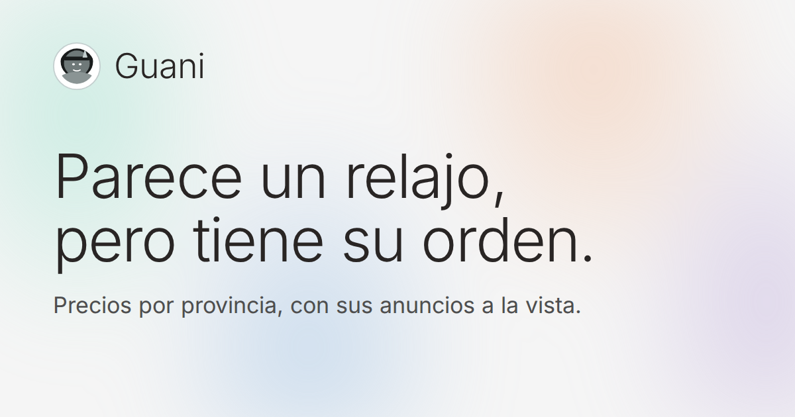
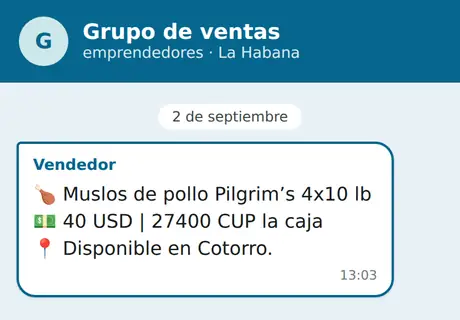
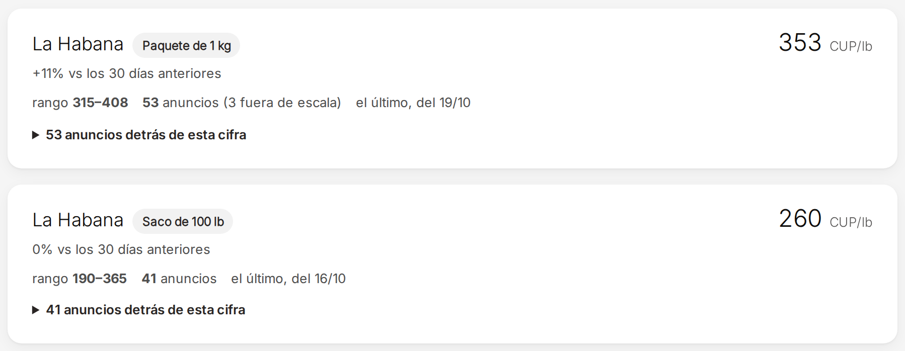
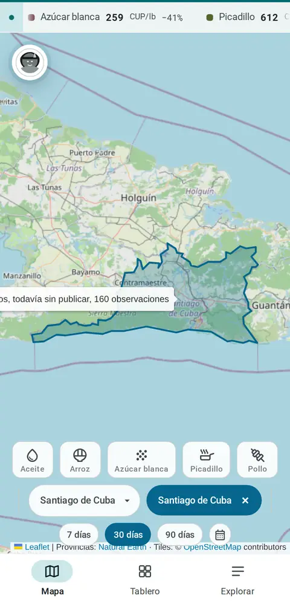
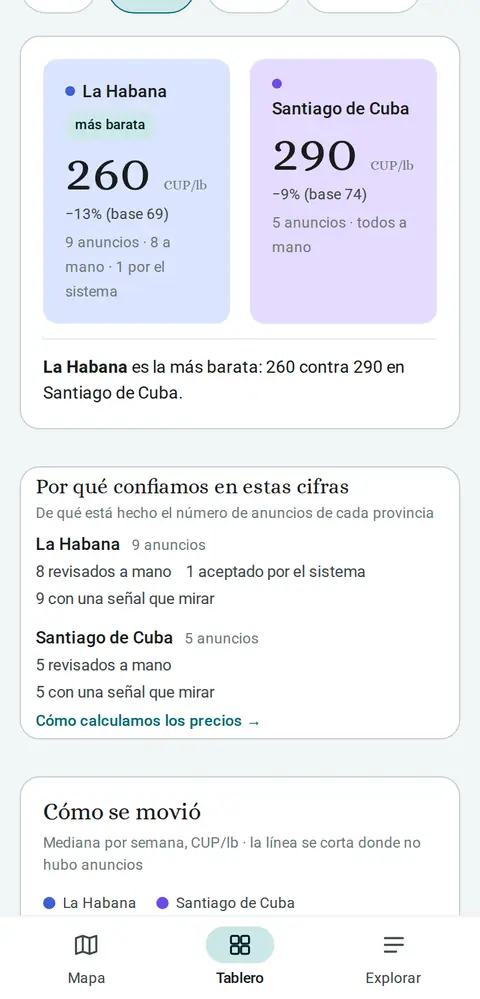
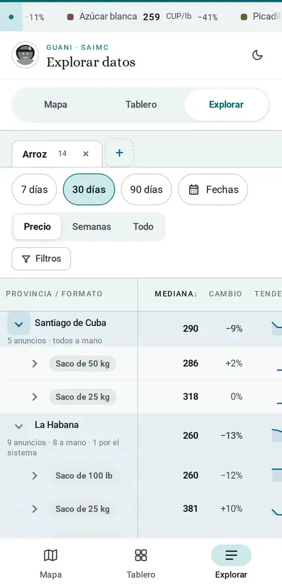

  

<strong>Medimos el mercado con la misma vara.</strong> · <a href="https://guani.app">guani.app</a>

Guani reúne los anuncios que emprendedores, TCP y negocios privados publican en
grupos y canales de WhatsApp, los convierte en una referencia de precios por
producto y por provincia, y deja que cualquiera compruebe de dónde sale cada
cifra.

---

## La idea

El mercado privado cubano parece caótico, pero tiene orden. Hay precios que se
repiten, diferencias entre provincias que se sostienen y cambios que se pueden
seguir semana a semana. Ese orden ya existe: está disperso en miles de anuncios
y nadie lo ve completo.

Guani no lo impone. Lo hace visible.

## La pregunta que responde

> ¿Cuánto se pide hoy por una libra de arroz en La Habana?

Hoy, quien quiere saberlo pregunta en diez grupos distintos y se queda con una
impresión. Todo empieza con anuncios como este, publicados en grupos de venta:

  

Ejemplo de anuncio (recreado).

Guani junta miles como ese y responde con una cifra y con su cuenta:

  

Cifras del 20 de octubre de 2026. El sitio muestra siempre las del día.

Cada cifra dice cuántos anuncios tiene detrás. Si son pocos, queda rotulada como
«muestra en formación» en lugar de presentarse como un dato firme.

## Cómo se ve

Guani está pensado primero para el teléfono, que es desde donde se consulta.
Tres vistas, tres preguntas:

<table align="center">
  <tr>
    <td align="center" width="33%">
       
      <strong>Mapa</strong> ¿Cuánto se pide en mi provincia?
    </td>
    <td align="center" width="33%">
       
      <strong>Tablero</strong> ¿Dónde es más barato, y por qué confiar?
    </td>
    <td align="center" width="33%">
       
      <strong>Explorar</strong> Todos los datos, por formato de venta.
    </td>
  </tr>
</table>

Capturas de la versión móvil. Las cifras cambian a diario.

## Cómo funciona

1. **Se leen los anuncios.** Los mensajes de los grupos y canales que Guani sigue
   llegan al sistema. Del total, la gran mayoría (alrededor de 8 de cada 10) no
   es un anuncio de precio —saludos, preguntas, ofertas sin cifra— y se aparta.
2. **Se extrae lo que importa.** De cada anuncio se sacan el producto, el precio,
   la moneda, la cantidad y la provincia. Una máquina hace la primera lectura.
3. **Lo difícil lo decide una persona.** Lo que el sistema ve claro lo acepta; lo
   dudoso pasa a una cola donde una persona lo revisa. Lo que el sistema acepta
   por su cuenta lo audita después una persona.
4. **Todo se pasa a la misma unidad.** Libras, kilos, sacos y paquetes se
   convierten a una medida común y los precios, a pesos cubanos, para que
   comparar tenga sentido.
5. **Se publica el rango y la mediana.** Un precio disparatado no manda: los
   valores atípicos se apartan con una regla publicada en
   [`/metodologia`](https://guani.app/metodologia).

## Por qué se puede comprobar

Cualquier página puede publicar un precio. Guani publica también su cuenta:

- **Cada cifra enseña sus anuncios.** Los anuncios de texto se abren desde el
  precio.
- **Cada cifra dice cuántos anuncios tiene detrás.**
- **La metodología es pública.** Qué se descarta y por qué, qué se convierte y
  cómo.
- **Se compara lo comparable.** Un saco de 40 lb y uno de 33 lb son series
  distintas, porque así se compra.

No hace falta creerlo: basta con verlo.

## Lo que Guani no hace

- **No opina.** Muestra el precio; no dice si es caro o barato ni qué conviene
  comprar. Cada quien decide qué hacer con él.
- **No compara con precios oficiales.**
- **Un anuncio dice lo que se pide, no lo que se paga.** Guani publica lo que se
  pide.
- **No guarda datos de contacto.** Ni teléfonos, ni nombres de quien vende, ni
  direcciones. No se publica quién puso el anuncio: se enseña el precio, no a la
  persona.
- **No cubre todo.** Hoy son cinco productos en dos provincias, y crece a medida
  que crece la muestra.

## Para quién es

Guani no elige un público ni decide el uso. Hay usos que ya se ven venir:

- **Quien compra**, para saber si lo que le piden es lo habitual en su provincia.
- **Quien vende**, para ver dónde cae su precio frente al de los demás.
- **Quien abastece o revende**, para ver qué se mueve y dónde.
- **Quien investiga o informa**, para tener una cifra con fuente y método.

## Dónde está hoy

Guani está en funcionamiento y recibe anuncios todos los días. Al 20 de octubre
de 2026:

- 7.223 mensajes recibidos de 48 canales y grupos.
- 6.030 apartados por no ser un anuncio de precio (83 %).
- 783 anuncios aceptados.
- 770 precios publicados para los últimos 30 días.

Lo que viene: crecer sin que el trabajo manual crezca al mismo ritmo, y sumar
productos y provincias.

## Verlo en dos minutos

- [La portada](https://guani.app): qué se publica hoy.
- [El arroz en La Habana](https://guani.app/producto/arroz?provincia=la-habana):
  una cifra con sus anuncios a la vista.
- [La metodología](https://guani.app/metodologia): cómo se calcula cada cifra.

Los datos de los últimos 30 días también se pueden descargar en
[CSV](https://guani.app/datos.csv). El uso comercial de los datos requiere un
acuerdo previo.

## Para quien desarrolla

El nombre técnico del proyecto es SAIMC (Sistema Abierto de Inteligencia de
Mercado para Cuba). Es una aplicación en Python (FastAPI, PostgreSQL). La guía
para instalarla y correrla está en [`docs/desarrollo.md`](docs/desarrollo.md), y
el orden de lectura del resto de la documentación, en
[`docs/empezar-aqui.md`](docs/empezar-aqui.md).

El código es visible, pero tiene todos los derechos reservados: no se concede
permiso de uso, copia ni distribución sin autorización escrita; ver
[`LICENSE`](LICENSE).

## Contacto

Guani, por Leira Studio · leirastudio@gmail.com
