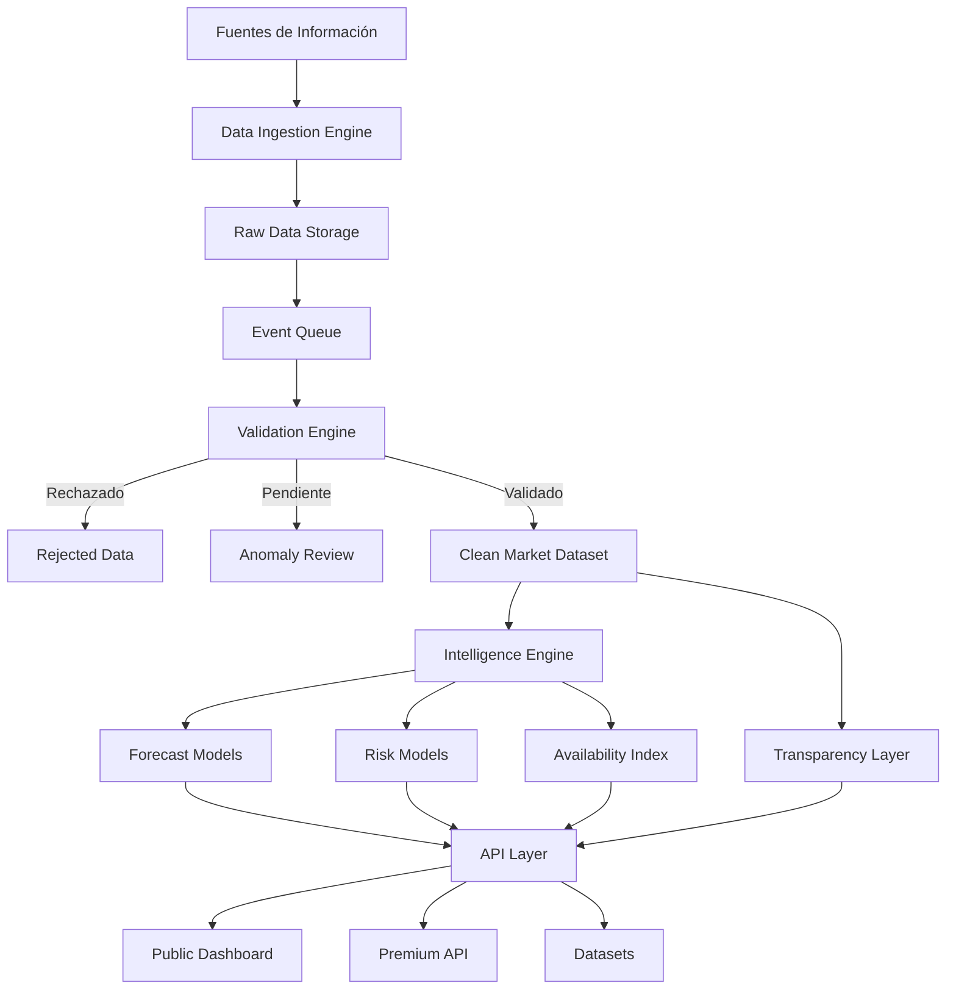
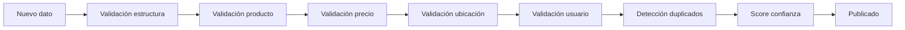
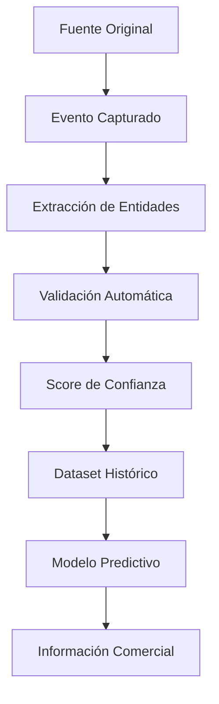
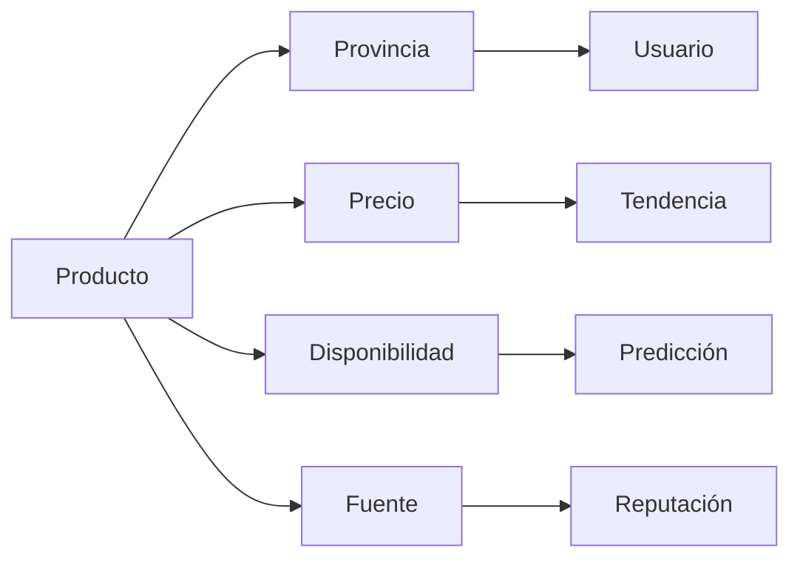
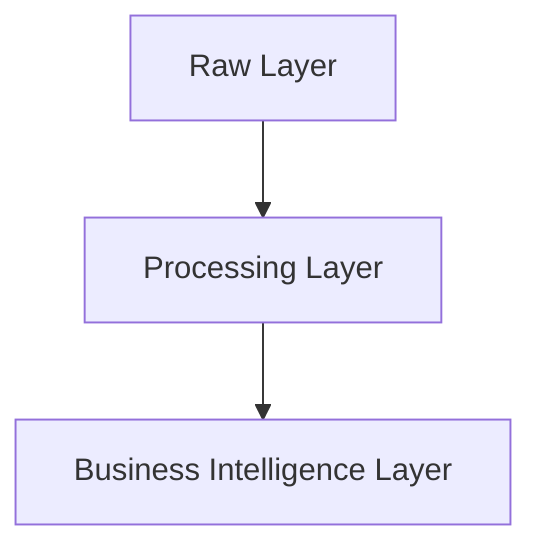
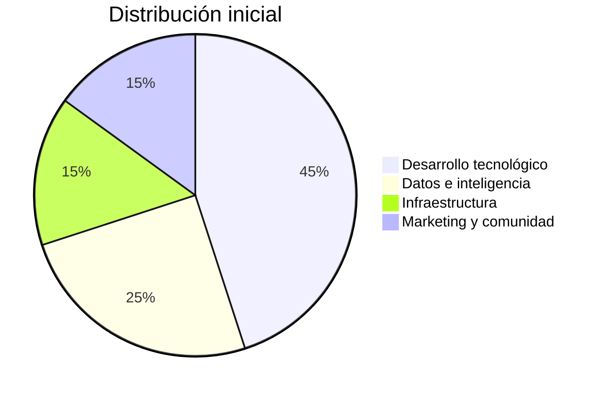

# 📄 Sistema Abierto de Inteligencia de Mercado para Cuba (SAIMC)

## Investor & Technical Whitepaper

### Versión 3.5 – Densidad Antes que Cobertura: Publicar Solo lo que Resiste

**Autor:** Ariel Hechavarria
**Fecha:** Agosto 2026  
**Estado:** Propuesta para Inversión / Implementación — Entrando en desarrollo

---

## Cambios respecto a la versión 3.4

Esta versión incorpora el resultado de una revisión del estado del arte. No modifica
la visión, el modelo de negocio ni la arquitectura. Corrige una premisa falsa, agrega
un riesgo que faltaba, y convierte dos supuestos implícitos en restricciones duras.

1. **Posicionamiento frente a elTOQUE reescrito** (sección 5). La diferenciación
   anterior se apoyaba en la opacidad metodológica del competidor. La metodología de
   la TRMI es pública. La diferenciación se reconstruye sobre ejes verificables:
   objeto medido, granularidad, y la naturaleza del problema técnico.
2. **Dependencia de tipo de cambio declarada** (secciones 5 y 6.3). SAIMC consume una
   referencia de tipo de cambio informal para normalizar precios entre monedas y no
   pretende producirla. Antes esto era un supuesto tácito; ahora es una dependencia
   externa con política de degradación y fuente de respaldo.
3. **Nuevo riesgo 10.7: manipulación adversarial de las series.** Existe un modelo de
   ataque públicamente articulado contra el sistema metodológicamente más cercano.
   SAIMC es estructuralmente más vulnerable. Cuatro contramedidas, con alcance
   declarado: elevar el costo del ataque y detectarlo, no alcanzar inmunidad.
4. **Umbral de densidad como condición de publicación** (sección 9). La
   sobreextensión geográfica es una causa documentada de fracaso en sistemas de
   información de mercado. Una provincia se publica cuando su densidad de datos lo
   sostiene, no cuando el calendario lo indica.
5. **Política de publicación metodológica** (sección 6.4.1). Se publica todo, con una
   única reserva declarada: los parámetros de la capa de detección de coordinación.
   Esto **acota** el principio de Transparencia Radical; no lo aclara.
6. **Parámetros pendientes de calibración** (sección 12.6). Los umbrales nuevos no se
   inventan: se miden sobre el primer despliegue.

---

## Cambios respecto a la versión 3.3

Esta versión no modifica la visión ni el modelo de negocio. Corrige una **inconsistencia estructural** que hacía el plan más riesgoso de lo necesario:

1. **Ingesta manual como modelo operativo real de la Fase 0**, no como paso preliminar simbólico. La v3.3 describía ingesta manual en la sección 6.1 pero luego el roadmap asumía captura automática de Telegram desde el mes 1. Se unifica el criterio: **primero curaduría humana, después APIs oficiales, después automatización asistida.**
2. **Hipótesis de extracción elevada a hipótesis crítica (H0)** con métrica de precisión medible contra un conjunto etiquetado a mano. Todo el resto del sistema depende de ella.
3. **Decisión de stack cerrada** (sección 13): Python de extremo a extremo en Fase 0–1, con Angular reservado para la Fase 2.
4. **Nuevo riesgo 10.6**: términos de servicio de plataformas externas y tratamiento de datos personales.
5. **Nuevas métricas de calidad de extracción** en la sección 12.
6. **Patrón de bandeja de entrada + cola de curaduría** (sección 6.1): la captura y la curaduría se separan en el tiempo. El OCR y la extracción por reglas pasan a ser asistentes de la cola, no etapas autónomas del pipeline. La cola de curaduría es simultáneamente herramienta de trabajo e instrumento de medición de H0.
7. **Aclaración del alcance de H0** (sección 3): H0 no bloquea el lanzamiento del dashboard público, bloquea la capacidad de escalar hacia forecasting y capa B2B.

---

# Índice

1. Resumen Ejecutivo  
2. Contexto y Problema del Mercado Cubano  
3. Hipótesis de Negocio (incluye H0 – Hipótesis Crítica)  
4. Usuarios Objetivo y Casos de Uso  
5. Diferenciación Estratégica Frente a Competidores Reales  
6. Arquitectura General del Sistema  
   - 6.1 Data Ingestion Engine (Modelo por etapas)  
   - 6.2 Validation Engine  
   - 6.3 Intelligence Engine  
   - 6.4 Transparency Layer  
     - 6.4.1 Política de publicación metodológica  
   - 6.5 Data Lineage Framework  
   - 6.6 Marketplace Intelligence Graph  
   - 6.7 Diseño de Interfaces y Visualización de Datos (NUEVO)  
7. Modelo de Datos  
8. Producto Comercial y Modelo de Monetización  
9. Roadmap de Implementación Realista  
10. Riesgos y Mitigaciones  
11. Anexo: Madurez del Forecast  
12. Métricas de Éxito (KPIs)  
13. Stack Tecnológico y Estrategia de Escalabilidad  
14. Solicitud de Inversión  
15. Conclusión Estratégica

---

# 1. Resumen Ejecutivo

El mercado cubano opera actualmente bajo un entorno caracterizado por alta volatilidad, fragmentación de información y ausencia de mecanismos confiables de inteligencia económica.

Millones de decisiones comerciales se toman diariamente basándose en información incompleta proveniente de canales informales como:

- grupos de Telegram,
- WhatsApp,
- Facebook Marketplace,
- redes sociales,
- comunidades comerciales privadas.

Estos canales contienen un enorme volumen de información económica, pero actualmente permanecen en un estado no estructurado: datos sin historial, sin validación, sin trazabilidad y sin capacidad predictiva.

El problema fundamental no es la falta de información.  
El problema es la falta de **inteligencia estructurada sobre esa información**.

---

## La oportunidad

SAIMC propone construir una infraestructura abierta de inteligencia de mercado capaz de transformar datos comunitarios desorganizados en:

- indicadores económicos confiables,
- tendencias regionales,
- predicciones de precios,
- modelos de riesgo,
- alertas comerciales,
- datasets históricos,
- APIs para integración empresarial.

**Todo presentado con un diseño visual, intuitivo y accesible para cualquier usuario, sin necesidad de conocimientos técnicos.** Mapas, semáforos de colores y gráficos claros que permiten tomar decisiones en segundos.

---

## El modelo operativo: curaduría primero

Un punto que distingue a SAIMC de un proyecto de scraping: **el sistema no nace automatizado, y esto es deliberado.**

La captura de datos evoluciona en tres etapas, y cada una solo se habilita cuando la anterior demostró funcionar:

| Etapa | Modo de captura | Qué valida | Cuándo se habilita |
| :--- | :--- | :--- | :--- |
| **E1 — Curaduría** | Un operador lee anuncios reales y los carga por interfaz administrativa | Que el mercado sea legible: que producto, precio y provincia se puedan extraer de forma consistente | Desde el día 1 |
| **E2 — Asistida** | El operador pega texto en bruto; el sistema propone la extracción y el humano confirma o corrige | Que las reglas de extracción alcancen precisión suficiente | Cuando E1 acumuló un conjunto etiquetado de referencia |
| **E3 — Automática** | APIs oficiales (Telegram Bot API sobre canales propios o autorizados) y fuentes con permiso explícito | Volumen y frescura | Cuando E2 supera el umbral de precisión definido en la sección 12.5 |

La curaduría manual no es una limitación temporal que hay que superar rápido. Es el mecanismo que **genera el conjunto de verdad (*ground truth*) contra el cual se mide todo lo demás.** Sin ese conjunto, la precisión del sistema es una afirmación sin evidencia.

Adicionalmente, este orden reduce riesgo legal y operativo: se construye valor sin depender desde el inicio de la extracción automatizada de plataformas de terceros (ver riesgo 10.6).

---

La plataforma no busca competir directamente con modelos orientados exclusivamente a publicar precios.  
La propuesta de valor es diferente:

> **SAIMC no vende solamente datos. Convierte datos dispersos en inteligencia económica verificable, predictiva y auditable, presentada de forma visual e inmediata.**

---

# Posicionamiento Estratégico

La plataforma se construye sobre cinco principios fundamentales:

## 1. Transparencia Radical

Cada dato mantiene una relación directa con su fuente original:

- texto capturado,
- imagen original,
- fecha,
- ubicación,
- usuario origen,
- reglas aplicadas,
- nivel de confianza.

El usuario puede conocer no solamente el resultado, sino también cómo fue generado.

Este principio tiene una excepción acotada y declarada: los parámetros de la capa de
detección de coordinación no se publican. El alcance exacto de la reserva y su motivo
están en la sección 6.4.1.

---

## 2. Validación Autónoma

El sistema utiliza un motor de reglas configurable capaz de filtrar automáticamente:

- errores humanos,
- spam,
- duplicados,
- datos inconsistentes,
- anomalías estadísticas.

El operador del sistema no valida manualmente cada dato.  
Administra las reglas que permiten al sistema validar la información.

---

## 3. Inteligencia Predictiva

SAIMC evoluciona desde un simple repositorio histórico hacia un sistema de predicción:

Ejemplo:

```
Producto: Pollo congelado
Provincia: Santiago de Cuba
Situación actual: Disponibilidad baja
Tendencia: Incremento esperado +12%
Horizonte: Próximos 7 días
Nivel de confianza: 87%
```

---

## 4. Infraestructura Abierta y Visual

La información procesada se consume mediante un dashboard **diseñado para ser leído en segundos**, no para requerir una clase magistral.

- **Mapas interactivos por provincia** donde el color indica el precio (verde = barato, rojo = caro, gris = sin datos).
- **Semáforos de tendencia**: flecha roja hacia arriba (sube), flecha verde hacia abajo (baja), círculo amarillo (estable).
- **Tarjetas de producto**: cada producto tiene su propia ficha con precio actual, variación semanal y recomendación simple ("Comprar ahora", "Esperar", "Escasez alta").
- **Nada de gráficos de velas ni indicadores complejos.** La información salta a los ojos.

Esto garantiza que cualquier cubano, sin importar su nivel técnico, pueda entender de un vistazo qué está pasando con los precios en su provincia.

---

## 5. Modelo B2B Sostenible

El sistema mantiene una capa pública gratuita para generar confianza y una capa premium orientada a:

- importadores,
- comerciantes,
- investigadores,
- agencias,
- startups.

---

# 2. Contexto y Problema del Mercado Cubano

## 2.1 Situación actual

El mercado cubano presenta características particulares:

- elevada variabilidad de precios,
- diferencias regionales significativas,
- cadenas de suministro poco transparentes,
- dependencia de mercados informales,
- dificultad para anticipar cambios.

Un comerciante puede conocer el precio actual de un producto, pero normalmente no puede responder preguntas estratégicas:

- ¿Subirá o bajará?
- ¿Dónde existe mayor disponibilidad?
- ¿Cuándo conviene comprar?
- ¿Qué productos tienen riesgo de escasez?
- ¿Qué provincia presenta mejores oportunidades?

---

## 2.2 El problema de los datos actuales

La información existente presenta cinco grandes limitaciones:

| Problema                | Consecuencia                        |
| ----------------------- | ----------------------------------- |
| Datos dispersos         | Imposibilidad de análisis histórico |
| Sin validación          | Baja confianza                      |
| Sin trazabilidad        | Difícil verificar origen            |
| Sin estructura          | Imposible automatizar               |
| Sin modelos predictivos | Solo describe el pasado             |

---

## 2.3 El problema desde la mirada del hogar (El verdadero motor)

Más allá del comercio B2B, existe una necesidad cotidiana y masiva que la plataforma resuelve:

> **Ejemplo real:** Una familia en Santiago de Cuba depende del aceite de cocina. En los grupos de Telegram se publican precios dispersos: "Aceite 500 CUP en tal tienda", "Aceite 620 CUP en el otro lado". Sin un sistema que centralice y muestre la tendencia, la familia no sabe si comprar hoy (pagando 600 CUP) o esperar a mañana (cuando quizá baje a 550 CUP). **Toman decisiones a ciegas.**

El usuario doméstico no necesita un modelo predictivo avanzado; necesita **visibilidad clara y confiable de lo que está pasando en su provincia, presentada de forma visual y rápida.** Este usuario es el que, al usar el dashboard diariamente, genera el tráfico, la confianza y la masa crítica que valida el sistema antes de que lleguen los grandes clientes B2B.

---

# 3. Hipótesis de Negocio

SAIMC parte de una hipótesis central:

> Si la información económica informal puede ser capturada, estructurada, validada y analizada mediante inteligencia artificial, entonces puede convertirse en una infraestructura comercial de alto valor para empresas e investigadores.

---

---

## H0 — La hipótesis crítica (debe validarse primero)

> **Los anuncios reales del mercado informal cubano contienen producto, precio y ubicación extraíbles de forma consistente y con precisión medible.**

Toda hipótesis posterior está río abajo de esta. Si la extracción sobre texto real —con abreviaturas, jerga regional, precios por unidades no estandarizadas, mezcla de monedas e información en imágenes— no alcanza precisión suficiente, entonces no hay dataset, no hay validación, no hay predicción y no hay producto.

**Cómo se valida:** durante la Etapa 1 (curaduría), el operador etiqueta manualmente un conjunto de referencia de al menos **300 anuncios reales**. Las reglas de extracción se miden contra ese conjunto.

**Criterio de decisión:**

| Precisión sobre el conjunto de referencia | Decisión |
| :--- | :--- |
| ≥ 85% | La hipótesis se sostiene. Avanzar a Etapa 2. |
| 70% – 85% | Viable con revisión humana obligatoria. Ajustar reglas antes de avanzar. |
| < 70% | **Detener y replantear.** El problema no es de ingeniería sino de legibilidad del mercado. |

Este número es el primer artefacto que un inversor puede evaluar: no una promesa de precisión, sino una medición.

**Qué bloquea y qué no bloquea H0.** H0 no condiciona el lanzamiento del dashboard público: un dashboard alimentado por curaduría humana entrega valor real al usuario doméstico desde el primer día, y esa es la estrategia de arranque. Lo que H0 condiciona es la **capacidad de escalar**: sin extracción precisa, el volumen del sistema queda limitado a lo que el operador pueda procesar a mano, y sin volumen no hay dataset histórico, ni forecasting, ni capa B2B. En otras palabras: el producto puede existir sin H0; la tesis del whitepaper no.

---

## Hipótesis secundarias

### H1
Los negocios están dispuestos a pagar por reducir incertidumbre.

### H2
Los datos históricos tienen más valor que los datos puntuales.

### H3
La confianza del dato es un activo comercial.

### H4
La predicción tiene mayor valor económico que la observación.

### H5
**El usuario doméstico es el motor de arranque.** Su necesidad diaria de consultar precios para su despensa genera el tráfico inicial, la retroalimentación y los datos comunitarios que dan viabilidad al sistema antes de que la capa B2B madure. Este usuario contribuye por reciprocidad: al ver inteligencia útil, se convierte en reportador activo.

---

# 4. Usuarios Objetivo y Casos de Uso

| Usuario        | Necesidad                  | Solución SAIMC          |
| -------------- | -------------------------- | ----------------------- |
| **Hogares / Consumidores finales** | Saber cuándo comprar para la casa sin especular. | Dashboard público gratuito con precios actuales y tendencia por provincia. **Mapas y semáforos visuales.** |
| Importadores   | Decidir cuándo comprar     | Predicciones y alertas  |
| Mayoristas     | Optimizar inventario       | Índices regionales      |
| Investigadores | Analizar economía informal | Dataset histórico       |
| Startups       | Crear aplicaciones         | API comercial           |
| Agencias       | Estudios de mercado        | Reportes especializados |

---

# 5. Diferenciación Estratégica Frente a Competidores Reales

A diferencia de lo que plantea el modelo conceptual genérico, el mercado cubano ya cuenta con actores tecnológicos relevantes en el espacio de inteligencia de precios. **SAIMC no compite en el mismo plano, sino que ocupa un nicho desatendido.**

## Mapa de competidores actuales

| Competidor | Enfoque | Modelo de Negocio | Fortaleza | Dónde queda el espacio para SAIMC |
| :--- | :--- | :--- | :--- | :--- |
| **elTOQUE — TRMI** | Tipo de cambio informal: una serie por moneda. | Medio de prensa; API para terceros. | Referencia de facto del mercado. Metodología pública y validada académicamente. | **No mide bienes.** Es infraestructura aguas arriba, no competencia. |
| **elTOQUE Markets** | Precios de productos, combustible, pasarelas de pago y márgenes. | Suscripción internacional (Tropipay) + vía local. | **Ya cobra.** Equipo mixto (técnico + periodístico) y supervisión académica (Pavel Vidal). | No expone el anuncio original detrás de cada precio ni el linaje del dato. Sin capa predictiva. |
| **CiberCuba Índice** | Precios barriendo miles de anuncios de Telegram/Facebook. | Publicidad / Gratuito. | **Validación automática anti-spam** en producción (similar a nuestro Validation Engine). | No transparenta el proceso de descarte. Sin enfoque B2B predictivo. |
| **A Ver Que Sale** | Comparador de precios en comercio formal (>100 tiendas). | Afiliación / Tráfico. | Catálogo masivo de productos formales. | No cubre mercado informal ni predicciones. |

---

## Posicionamiento diferencial de SAIMC

| Atributo | elTOQUE Markets | CiberCuba | A Ver Que Sale | **SAIMC** |
| :--- | :--- | :--- | :--- | :--- |
| **Mercado objetivo** | Consumidor final + comerciante | Consumidor general | Comprador online | **Hogares + B2B + Investigadores** |
| **Fuente de datos** | Interna / Mixta | Scraping público | Scraping formal | **Comunitaria + Scraping + Operador** |
| **Trazabilidad del dato** | No expone el anuncio de origen | No expone el anuncio de origen | Directa de tienda | **Radical (anuncio original visible)** |
| **Validación** | Interna | Automática, proceso de descarte no publicado | Directa de tienda | **Reglas públicas + Reputación + Lógica de negocio abierta** |
| **Valor principal** | Precio actual y margen | Precio actual | Precio formal | **Predicción + Riesgo + Dataset histórico** |
| **Visualización** | Funcional / Tablas | Listados | Catálogo | **Mapas, semáforos, tarjetas intuitivas** |
| **Modelo de ingresos** | Suscripción | Publicidad | Afiliación | **Freemium + API + Datasets** |

El eje de diferenciación es la **trazabilidad por dato**, no la apertura metodológica.
La distinción importa y la sección siguiente la desarrolla.

---

## Posicionamiento frente a elTOQUE

elTOQUE opera desde 2021 la Tasa Representativa del Mercado Informal (TRMI), la
referencia de facto para el valor del peso cubano frente a divisas. Su metodología es
pública: recolección automatizada de anuncios de compra y venta en redes sociales
mediante bots, procesamiento con herramientas de NLP, cálculo por mediana sobre ventana
de 24 horas con filtrado de valores extremos, y promedio móvil exponencial para monedas
de baja densidad de datos.

**SAIMC no se diferencia por transparencia metodológica.** Esa afirmación sería falsa y
comprobable en minutos. La diferenciación es de objeto, de granularidad y de naturaleza
técnica del problema.

Queda en pie una diferencia distinta y más precisa: **la trazabilidad por dato**. Que la
metodología sea pública no implica que cada precio publicado sea rastreable hasta el
anuncio que lo originó. Eso —el Data Lineage Framework de la sección 6.5 y la
Transparency Layer de la 6.4— sigue siendo propio de SAIMC. La afirmación defendible no
es «ellos son opacos», es «nosotros mostramos la evidencia de cada celda».

### Ejes de diferenciación

| Eje | elTOQUE (TRMI) | SAIMC |
| :--- | :--- | :--- |
| Objeto medido | Divisas: un valor por moneda | Bienes de consumo: matriz producto × provincia |
| Cardinalidad de salida | ~5 series | Cientos de series simultáneas |
| Granularidad geográfica | Nacional | Provincial |
| Homogeneidad del bien | Alta: un dólar es un dólar | Baja: «aceite» abarca decenas de presentaciones |
| Densidad de datos por serie | Alta: cientos de anuncios diarios | Baja y desigual entre provincias |
| Problema técnico dominante | Extracción de intención y valor | Extracción **más resolución de entidades** |
| Trazabilidad de la salida | Metodología pública, dato individual no expuesto | Anuncio original visible detrás de cada precio |
| Modelo de apertura | Metodología pública, implementación cerrada | Código, esquema y datos agregados abiertos |

### El problema técnico es de otra clase

La diferencia de fondo no es de escala sino de tipo. La TRMI resuelve un problema de
**extracción**: identificar en un mensaje si hay intención de compra o venta, qué moneda
y qué valor. El bien subyacente es perfectamente homogéneo y no requiere normalización.

SAIMC enfrenta ese mismo problema **más uno adicional que la TRMI no tiene**: la
resolución de entidades. Un anuncio de «aceite girasol 1L marca X» y otro de «aceite
900ml» deben resolverse a una misma unidad comparable, o a unidades distintas declaradas
como tales, antes de que cualquier estadística sea válida. Esto implica normalización de
unidades, agrupamiento de presentaciones equivalentes, y decisiones explícitas de
comparabilidad que la medición de tipo de cambio nunca necesita tomar.

Esa capa de normalización es el núcleo técnico de SAIMC y el activo transferible del
proyecto. Es también la razón por la que H0 (sección 3) es la hipótesis crítica: mide
exactamente esa capacidad.

### Relación de complementariedad, no de sustitución

Los anuncios del mercado informal cubano se expresan en múltiples monedas —CUP, USD,
EUR, MLC— con frecuencia dentro del mismo canal y a veces dentro del mismo mensaje.
Cualquier serie de precios comparable en el tiempo requiere una base monetaria común, y
por tanto un tipo de cambio informal de referencia.

SAIMC **consume** esa referencia; no la produce ni pretende producirla. elTOQUE publica
una API para acceso a la TRMI por terceros, lo que la convierte en infraestructura
aguas arriba del pipeline de SAIMC.

Esto tiene tres consecuencias que el diseño debe reconocer explícitamente:

1. **Dependencia declarada.** La normalización monetaria de SAIMC hereda las propiedades
   estadísticas y los riesgos de disponibilidad de su fuente de tipo de cambio. Debe
   estar documentada como dependencia externa, con política de degradación definida
   (última tasa conocida, ventana de validez máxima, marcado explícito de series
   calculadas con tasa vencida).
2. **Redundancia obligatoria.** Una dependencia crítica de una sola fuente externa es un
   punto único de fallo. El diseño debe contemplar al menos una fuente alternativa de
   tipo de cambio, aunque en operación normal se privilegie la TRMI.
3. **Atribución.** Toda serie derivada que use la TRMI como base de conversión debe
   atribuirla visiblemente.

La implementación de esta dependencia está en la sección 6.3, componente E.

### Riesgo de coordinación

La adopción de una referencia de precios es un problema de punto focal: el valor de la
referencia crece con el número de actores que la usan, lo que tiende a producir
concentración en un único proveedor por categoría. elTOQUE alcanzó esa posición para
divisas.

SAIMC opera en una categoría distinta y hoy desatendida, pero el mismo mecanismo aplica:
el primero en alcanzar credibilidad y adopción suficientes en inteligencia de precios de
bienes tenderá a consolidarse. **La ventana no es indefinida**, y la variable crítica no
es la calidad técnica sino la adopción temprana en un nicho suficientemente acotado como
para alcanzarla.

De ahí la estrategia de lanzamiento por provincias descrita en la sección 9.

---

## Declaración de nicho

> **SAIMC no es "otro agregador de precios". Es la primera infraestructura abierta de inteligencia predictiva para el mercado informal cubano, con trazabilidad total y foco en decisiones estratégicas B2B, pero que nace resolviendo la necesidad diaria del hogar cubano con una interfaz visual que cualquier persona puede entender en segundos.**

Mientras elTOQUE Markets cobra por decir "cuánto cuesta hoy", SAIMC cobrará por decir "qué va a pasar mañana y por qué", mientras empodera al usuario común para decidir su compra del día a día con mapas y colores que saltan a la vista.

---

# 6. Arquitectura General del Sistema

La arquitectura SAIMC 3.0 está diseñada bajo un principio fundamental:

> **Separar la captura de información, la validación, el procesamiento inteligente y la distribución del conocimiento.**

Esto permite que el sistema pueda comenzar como un MVP pequeño y evolucionar progresivamente hacia una infraestructura nacional de inteligencia económica.

La arquitectura utiliza un modelo basado en eventos (*event-driven architecture*) donde cada nueva información genera un evento que atraviesa diferentes capas de procesamiento.

---

# Arquitectura de Alto Nivel



---

## 6.1 Data Ingestion Engine

### Objetivo

Capturar información económica desde múltiples fuentes y convertirla en eventos estructurados sin perder el origen original del dato.

El principio fundamental es:

> "Primero almacenar, después interpretar."

Ningún dato recibido se modifica directamente.  
Cada entrada inicial se conserva como evidencia original.

---

### Fuentes de información — Modelo por etapas

El Data Ingestion Engine se construye una sola vez, pero se **alimenta de forma distinta según la etapa**. La interfaz de entrada al sistema es siempre la misma: un evento crudo en `raw_ingestions`. Lo que cambia es quién o qué lo produce.

Esto es una decisión de arquitectura, no un atajo: significa que pasar de curaduría manual a APIs no requiere reescribir el pipeline, solo agregar un productor de eventos.

---

#### Etapa 1 — Captura y curaduría diferida (desde el día 1)

**Principio de diseño:** la captura y la curaduría son actos separados en el tiempo. Unificarlos en un solo formulario obliga al operador a detenerse a estructurar información justo cuando está navegando, lo que hace la rutina insostenible.

```
Captura (segundos, en el móvil)  →  Bandeja de entrada  →  Cola de curaduría (en bloque)
```

**a) Captura.** El operador guarda el anuncio en el formato que sea más rápido en ese momento: captura de pantalla, copia del texto, foto. Sin estructurar nada. El único requisito es que el material llegue al directorio de entrada.

**b) Bandeja de entrada.** Un directorio observado por el sistema. Cada archivo nuevo se registra como un `raw_ingestion` con:

- referencia al archivo original (evidencia preservada),
- hash del contenido para deduplicación,
- tipo de contenido (imagen / texto),
- fecha de captura,
- estado de procesamiento (`pending` / `curated` / `discarded`).

El archivo original **nunca se modifica ni se elimina**. Es la base de la Transparency Layer: el anuncio que respalda cada precio publicado es literalmente el archivo capturado.

**c) Cola de curaduría.** Interfaz que presenta un elemento pendiente por vez:

- muestra la imagen o el texto original,
- ofrece los campos a completar: producto, precio, moneda, cantidad, unidad, provincia, canal origen, fecha de publicación,
- permite descartar el elemento si no contiene información económica útil,
- permite marcarlo como parte del conjunto de referencia.

**Volumen objetivo:** aproximadamente una hora diaria de curaduría. La captura no cuenta como tiempo de trabajo porque ocurre durante el uso normal de las redes.

**Ventaja adicional del patrón:** la bandeja de entrada es una interfaz genérica. Cuando en la Etapa 3 se habiliten fuentes automáticas, estas escriben en la misma bandeja. El pipeline de curaduría no cambia: solo cambia quién deposita los elementos.

---

#### Rol del OCR y la extracción asistida

Tanto el OCR (para imágenes) como la extracción por reglas (para texto) se incorporan **como asistentes de la cola de curaduría**, no como etapas autónomas del pipeline.

El sistema propone; el operador confirma o corrige. Esto evita que el error de OCR se acumule sobre el error de extracción sin supervisión, y convierte cada acción de curaduría en un dato de evaluación de precisión.

```
Elemento pendiente → OCR/extracción propone → Operador confirma o corrige → Registro validado
                                                            ↓
                                              Evento de evaluación (métrica H0)
```

**La cola de curaduría es simultáneamente la herramienta de trabajo y el instrumento de medición.** No hay que construir un sistema de evaluación aparte: la rutina diaria lo genera.

---

#### Etapa 2 — Extracción asistida (validación de H0)

El operador pega **solo el texto en bruto**. El sistema propone la extracción estructurada y el humano confirma, corrige o rechaza.

```
Texto pegado:   "🐔 pollo congelado cajas de 40lb a 12000 stgo entrega dom"

Propuesta del sistema:
  producto:   pollo congelado    ✓ confirmar   ✗ corregir
  precio:     12000              ✓ confirmar   ✗ corregir
  moneda:     CUP (inferida)     ✓ confirmar   ✗ corregir
  cantidad:   40 lb              ✓ confirmar   ✗ corregir
  provincia:  Santiago de Cuba   ✓ confirmar   ✗ corregir
```

Cada confirmación o corrección alimenta directamente la métrica de precisión. **La interfaz de curaduría se convierte en el instrumento de medición.** Esto es lo que hace que la Etapa 1 no sea trabajo desechable.

**Tecnología:** reglas y diccionarios (regex, catálogo de productos con alias, catálogo geográfico oficial) como primera línea; LLM únicamente para los casos que las reglas no resuelven, con el resultado siempre sujeto a confirmación humana.

---

#### Etapa 3 — Fuentes automáticas (solo tras superar el umbral de H0)

Se habilita **exclusivamente** cuando la Etapa 2 supera el umbral de precisión, y siguiendo un orden de menor a mayor riesgo legal:

**3a. Telegram vía API oficial.** Bot API sobre canales propios o canales de terceros donde exista autorización explícita del administrador. Es la vía de menor riesgo y debe agotarse primero.

**3b. Aportes de la comunidad.** Botón "subir dato" en el dashboard público, sujeto al Validation Engine y al sistema de reputación. Es la fuente que escala mejor y la que no depende de terceros.

**3c. Otras fuentes.** Cualquier fuente adicional requiere evaluación previa de términos de servicio y tratamiento de datos personales (ver riesgo 10.6). **No se asume viable por defecto.**

**Nota sobre el OCR.** El OCR ya opera desde la Etapa 1 como asistente de la cola de curaduría (ver arriba). Lo que se habilita en la Etapa 3 no es el OCR sino su ejecución **sin confirmación humana**, y solo para los tipos de anuncio donde la precisión medida lo justifique.

---

### Modelo de Evento Inicial

Toda información capturada genera un evento:

```json
{
  "event_id": "evt_001245",
  "source": {
    "type": "telegram",
    "origin": "grupo_publico_xyz"
  },
  "captured_at": "2026-07-28T10:30:00",
  "raw_content": {
    "text": "Pollo 950 CUP Santiago",
    "image": null
  },
  "status": "pending_validation"
}
```

---

## 6.2 Validation Engine

### El núcleo diferencial de SAIMC

El Validation Engine es responsable de responder una pregunta crítica:

> ¿Podemos confiar en este dato?

El sistema no asume que una publicación es correcta.  
Cada entrada pasa por un pipeline de validación.

---

### Pipeline de Validación



---

### Reglas de Validación

#### Regla 1 — Estructura mínima

El dato debe contener: producto reconocido, valor numérico, unidad monetaria, contexto suficiente.

Ejemplo válido: `Pollo 950 CUP Santiago`  
Ejemplo inválido: `Disponible barato`

---

#### Regla 2 — Coherencia del precio

El sistema no utiliza solamente un promedio nacional.  
Modelo:

```
Precio esperado = 70% promedio provincial + 30% tendencia nacional
```

Esto permite reflejar diferencias reales entre regiones.

Ejemplo:  
Producto: Arroz  
Provincia: Santiago  
Precio histórico: 200 CUP/kg  
Tendencia nacional: +10%  
Precio esperado: 210 CUP/kg  

Si llega `Arroz 220 CUP/kg` → **VALIDADO**  
Si llega `Arroz 900 CUP/kg` → **ANOMALÍA**

---

#### Regla 3 — Validación geográfica

El sistema verifica: provincias oficiales, municipios, regiones comerciales.  
Ejemplo:  
Entrada: `Pollo 950 CUP Oriente` → el sistema puede mantener `Zona: Oriente, Provincia: No determinada`  
Pero no acepta: `Pollo 950 CUP Wakanda`

---

#### Regla 4 — Sistema de reputación dinámica

Cada usuario posee:

```json
{
  "user_id": "usr_123",
  "trust_score": 78,
  "level": "trusted_source"
}
```

**Estados:**

| Score  | Estado            |
| ------ | ----------------- |
| 0-30   | Bloqueado         |
| 31-60  | Usuario normal    |
| 61-80  | Usuario confiable |
| 81-100 | Fuente verificada |

**Evolución del score:**

| Evento                  | Cambio |
| ----------------------- | -----: |
| Dato confirmado         |    +10 |
| Historial consistente   |     +5 |
| Precio falso confirmado |    -20 |
| Spam                    |    -15 |
| Duplicado               |     -5 |

---

#### Regla 5 — Deduplicación

El sistema compara: hash del texto, similitud semántica, imagen, fecha, fuente.

Ejemplo:  
Publicaciones: `"Pollo congelado 950 CUP"` y `"Vendo pollo 950 pesos"`  
El motor NLP determina similitud del 94% → **Posible duplicado**

---

#### Regla 6 — Coherencia cantidad/precio

Ejemplo:  
Entrada: `Caja pollo 40 libras, Precio 500 CUP`  
El sistema compara historial, peso, unidad, precio esperado.  
Resultado: **Inconsistencia detectada**

---

### Resultado de validación

Cada dato obtiene:

```json
{
  "validation_status": "approved",
  "confidence_score": 94,
  "rules": {
    "structure": true,
    "price": true,
    "location": true,
    "trust": true,
    "duplicate": true
  }
}
```

---

## 6.3 Intelligence Engine

### Objetivo

Transformar datos validados en inteligencia accionable.  
El sistema deja de responder "¿Cuánto cuesta?" y empieza a responder "¿Qué probablemente ocurrirá?"

---

### Componentes principales

#### A) Extracción Inteligente de Entidades

Tecnologías:

- **MVP:** Regex, Diccionarios, LLMs
- **Escala:** spaCy, modelos entrenados con lenguaje cubano

Extrae: Producto, Precio, Moneda, Cantidad, Ubicación, Fecha, Proveedor

---

#### B) Forecasting

Modelos: Prophet, ARIMA, modelos estadísticos personalizados

Predicción:

```json
{
  "product": "pollo",
  "province": "Santiago",
  "current_price": 950,
  "forecast_7_days": {
    "expected": 1065,
    "confidence": 0.87
  }
}
```

---

#### C) Índice de Disponibilidad (Availability Index 0-100)

Combina: frecuencia de publicaciones, velocidad de desaparición, volumen histórico, menciones.

Ejemplo:  
Pollo → Disponibilidad: 32/100 → **Escasez alta**

---

#### D) Modelo de Riesgo Comercial

Calcula sensibilidad: Producto → Dependencia dólar informal → Importación → Disponibilidad → Riesgo

Ejemplo:  
Producto: Aceite vegetal  
Riesgo: Alto  
Motivo: Alta correlación USD informal

---

#### E) Normalización Monetaria

Los anuncios llegan en CUP, USD, EUR y MLC, a veces mezclados dentro del mismo canal.
Una serie temporal comparable exige una base monetaria única. SAIMC adopta **CUP como
moneda base de las series publicadas** y convierte el resto usando una referencia
externa de tipo de cambio informal.

**Esta es una dependencia externa declarada, no un detalle de implementación.** Las
propiedades estadísticas y la disponibilidad de la fuente de tipo de cambio se heredan
íntegras. El diseño la trata como tal:

| Aspecto | Regla |
| :--- | :--- |
| Fuente primaria | TRMI de elTOQUE, vía su API pública |
| Fuente de respaldo | Al menos una alternativa configurada; una sola fuente crítica es punto único de fallo |
| Persistencia | Toda conversión guarda la tasa aplicada y su fecha junto al registro, no solo el resultado |
| Degradación | Ante fuente no disponible: última tasa conocida, con ventana de validez máxima |
| Tasa vencida | La serie se marca explícitamente como calculada con tasa fuera de ventana |
| Atribución | Toda serie derivada de la TRMI la atribuye visiblemente |

La regla de persistencia no es negociable: sin la tasa histórica almacenada, un cambio
retroactivo en la fuente reescribe silenciosamente toda la serie y rompe la
reproducibilidad que sostiene la sección 6.5.

**Alcance en Fase 0.** Mientras los productos bandera se anuncien mayoritariamente en
CUP, la conversión es un caso de borde y no bloquea nada. Lo que sí corresponde desde el
primer modelo de datos es guardar moneda y tasa aplicada: agregarlas después obliga a
reprocesar registros crudos.

---

## 6.4 Transparency Layer

La confianza es un producto.  
SAIMC no oculta el origen.  
Cada dato tiene una cadena visible:

```
Fuente original
       |
       ↓
Dato extraído
       |
       ↓
Validaciones aplicadas
       |
       ↓
Resultado inteligente
```

---

### Pirámide de Transparencia

```
           PREMIUM
              ▲
              |
     Predicciones y modelos
              ▲
              |
     Métricas e indicadores
              ▲
              |
     Datos estructurados
              ▲
              |
     Fuente original
```

---

### 6.4.1 Política de publicación metodológica

#### Principio

SAIMC adopta el principio de Kerckhoffs aplicado a la integridad metodológica: **el
sistema debe resistir manipulación aunque toda su metodología sea pública.**

Si la publicación de los umbrales de validación comprometiera la integridad de las
series, el problema no estaría en la publicación sino en el diseño. La resistencia a
manipulación proviene de la arquitectura descrita en la sección 10.7 —redundancia de
fuentes, estimadores robustos, índice de control paralelo, umbrales mínimos de muestra—
y no del desconocimiento de un parámetro.

Esta decisión es además consistente con el nombre y el propósito del proyecto: un
sistema abierto cuya metodología no es auditable no es abierto.

#### Qué se publica

Sin excepciones:

- Fórmulas de agregación y cálculo de índice, con su justificación.
- Umbrales de validación y de densidad mínima, con los valores vigentes.
- Reglas del motor de validación (sección 6.2).
- Criterios de normalización y agrupamiento de productos.
- Ventanas temporales de cálculo y tasa de cambio aplicada.
- Canales y tipos de fuente monitoreados, a nivel de categoría.
- Métricas de calidad: precisión de extracción medida, volumen de observaciones
  válidas, cobertura por provincia, tasa de rechazo del validador.
- Código fuente del pipeline.
- Datos agregados publicados, con su historial de versiones.

#### Qué se reserva

Únicamente los **parámetros específicos de la capa de detección de coordinación** (C4 de
la sección 10.7): umbrales de sincronía, métricas de similitud textual, criterios de
puntuación de fuentes sospechosas.

La justificación es acotada y explícita: estas heurísticas son de naturaleza antifraude
y su eficacia se degrada al publicarse, del mismo modo que ocurre con las reglas de
detección de fraude en sistemas de pago o con los filtros antispam. No son parte de la
metodología de medición: no intervienen en cómo se calcula un precio, solo en qué
observaciones se marcan para revisión.

**Esta reserva se declara públicamente, junto con su motivo.** SAIMC no oculta que
existe una capa reservada; publica que existe, qué hace, y por qué sus parámetros no se
exponen. La distinción entre «hay una capa antifraude cuyos parámetros no publico, y lo
digo» y «no publico mi metodología» es sustantiva y debe quedar explícita.

> **Nota sobre el principio 1.** Esta política **acota** la Transparencia Radical
> declarada en el Posicionamiento Estratégico; no la aclara. Antes de la v3.5 el
> compromiso era sin reservas. La reserva es defendible, pero es una reducción del
> alcance y se registra como tal.

#### Auditabilidad

Los valores reservados se documentan internamente con el mismo rigor que los públicos y
quedan disponibles para auditoría por terceros bajo acuerdo, sin publicación abierta.

#### Revisión

Esta política se revisa si aparece evidencia de que la reserva es insuficiente o
excesiva. Cualquier ampliación del alcance de lo reservado requiere justificación
documentada en `docs/decisions.md` y se anuncia públicamente.

---

## 6.5 Data Lineage Framework

### Sistema de Trazabilidad Completa del Dato

Uno de los principales problemas de los mercados informales es que la información pierde contexto rápidamente.  
Un precio sin origen, fecha o evidencia tiene un valor limitado.

SAIMC introduce un modelo de **Data Lineage** donde cada dato mantiene una historia completa desde su captura hasta su transformación en inteligencia.

---

### Principio fundamental

> **Todo dato publicado debe poder responder cuatro preguntas:**
> 1. ¿De dónde salió?
> 2. ¿Cuándo fue capturado?
> 3. ¿Qué procesos atravesó?
> 4. ¿Por qué el sistema confía en él?

---

### Flujo de vida del dato



---

### Ejemplo completo de trazabilidad

Un usuario publica: `"Pollo congelado 950 CUP Santiago"`

El sistema almacena:

```json
{
  "record_id": "SAIMC-20260728-00001",
  "source": {
    "type": "telegram",
    "channel": "mercado_santiago",
    "captured_at": "2026-07-28T10:30:00"
  },
  "original_data": {
    "text": "Pollo congelado 950 CUP Santiago"
  },
  "extracted_data": {
    "product": "pollo congelado",
    "price": 950,
    "currency": "CUP",
    "province": "Santiago de Cuba"
  },
  "validation": {
    "structure": true,
    "price_range": true,
    "location": true,
    "duplicate_check": true
  },
  "trust": {
    "user_score": 82,
    "confidence_score": 94
  },
  "status": "approved"
}
```

---

### Beneficios estratégicos

- **Para usuarios públicos (hogares):** Permite saber si el precio de hoy es justo o está inflado, y anticipar si conviene comprar ahora, todo visto en un mapa o semáforo de colores.
- **Para investigadores:** Permite construir estudios económicos, análisis históricos, modelos sociales.
- **Para empresas:** Permite justificar decisiones con evidencia verificable.

---

## 6.6 Marketplace Intelligence Graph

### Grafo de Inteligencia del Mercado

SAIMC no solamente almacena datos. Construye relaciones.  
El mercado completo puede representarse como un grafo dinámico donde cada elemento está conectado.

---

### Modelo conceptual



---

### Ejemplo: Producto Pollo congelado

```
                Pollo
                  |
     -----------------------------
     |             |             |
 Santiago       Habana       Holguín
     |             |             |
  950 CUP      1100 CUP      980 CUP
     |             |             |
 Telegram      Marketplace    Usuario X
```

El sistema puede responder:

**Pregunta tradicional:** ¿Cuál es el precio del pollo?  
Respuesta: 1.000 CUP promedio.

**Pregunta inteligente:** ¿Dónde conviene comprar pollo esta semana?  
Respuesta: Santiago presenta menor precio promedio y mayor disponibilidad proyectada durante los próximos 7 días.

---

### Valor competitivo del grafo

Con el tiempo SAIMC acumula un activo difícil de replicar:

- relaciones históricas,
- comportamiento regional,
- confiabilidad de fuentes,
- patrones de oferta,
- comportamiento estacional.

El verdadero activo no es la base de datos. Es el conocimiento acumulado sobre cómo funciona el mercado.

---

## 6.7 Diseño de Interfaces y Visualización de Datos (NUEVO)

### Principio de diseño

> **La información debe saltar a los ojos. No se necesita una maestría para entender un gráfico.**

A diferencia de plataformas financieras como TradingView, donde los gráficos de velas y los indicadores técnicos requieren conocimiento especializado, SAIMC está diseñado para que **cualquier cubano, en 5 segundos, entienda la situación de su producto en su provincia.**

---

### Componentes visuales del Dashboard

#### 1. Mapa de Calor por Provincia

- Cada provincia tiene un color según el precio promedio del producto seleccionado.
- **Verde:** Precio por debajo del promedio nacional.
- **Amarillo:** Precio en el promedio.
- **Rojo:** Precio por encima del promedio.
- **Gris:** Sin datos suficientes.

El usuario puede hacer clic en una provincia para ver el detalle.

#### 2. Tarjeta de Producto (Vista Principal)

Cada producto tiene una tarjeta que resume la información clave:

```
┌─────────────────────────────────────┐
│  🥩 POLLO CONGELADO                 │
│  Santiago de Cuba                   │
│                                      │
│  Precio actual:  950 CUP            │
│  Promedio semana: 920 CUP           │
│                                      │
│  Tendencia:  ▲  +3.2%  (últimos 7d)│
│                                      │
│  Recomendación:  ⚠️ COMPRAR AHORA   │
│  (Se espera subida a 1065 CUP)      │
│                                      │
│  Disponibilidad: 🔴 Baja (32/100)   │
│                                      │
│  Confianza del dato:  ████████░░ 94%│
└─────────────────────────────────────┘
```

#### 3. Semáforo de Tendencia (Sin números complicados)

- **🟢 Flecha verde hacia abajo:** El precio está bajando. Buen momento para esperar.
- **🟡 Círculo amarillo:** El precio está estable. Puedes comprar sin urgencia.
- **🔴 Flecha roja hacia arriba:** El precio está subiendo. Conviene comprar ahora.

#### 4. Gráfico de Evolución Simple (No velas)

En lugar de gráficos de velas japonesas, se usa un gráfico de líneas simple con:

- **Eje X:** Fechas (últimos 30 días).
- **Eje Y:** Precio.
- **Línea azul:** Precio promedio.
- **Banda gris:** Rango mínimo y máximo.
- **Línea punteada naranja:** Predicción a 7 días.

Esto muestra de forma clara si el precio está subiendo o bajando, sin necesidad de interpretar patrones complejos.

#### 5. Alertas Visuales (Destellos)

- Si un producto tiene una variación del precio > 10% en 24 horas, la tarjeta **parpadea en naranja** con la palabra "ALERTA".
- Si la disponibilidad cae por debajo de 30/100, la tarjeta **parpadea en rojo** con "ESCASEZ".

---

### Filosofía de diseño

> **No se necesita saber de finanzas para entender si el aceite está caro o barato hoy en Santiago.**

El usuario abre la página, ve un mapa de Cuba coloreado, busca su provincia, ve el producto y en 3 segundos sabe:
- ¿Está caro o barato?
- ¿Sube o baja?
- ¿Compro ahora o espero?

Esa es la verdadera inteligencia de mercado: **información que se entiende sin esfuerzo.**

---

# 7. Modelo de Datos Inicial

La arquitectura de datos está diseñada para separar:

1. Datos originales.
2. Datos procesados.
3. Inteligencia generada.

---

## Capas principales



---

## 7.1 Raw Layer

Contiene información sin modificar.

Tabla: **raw_ingestions**

```sql
CREATE TABLE raw_ingestions (
  id UUID PRIMARY KEY,
  source_type VARCHAR(50),        -- inbox_image | inbox_text | telegram_api | community
  source_reference TEXT,          -- canal o grupo de origen
  file_path TEXT,                 -- ruta a la evidencia original preservada
  content_hash VARCHAR(64),       -- deduplicación de capturas repetidas
  content_type VARCHAR(20),       -- image | text
  original_text TEXT,             -- texto pegado o transcrito
  processing_status VARCHAR(20),  -- pending | curated | discarded
  captured_at TIMESTAMP,
  created_at TIMESTAMP
);

CREATE UNIQUE INDEX idx_raw_ingestions_hash ON raw_ingestions (content_hash);
```

Características: solo lectura, auditoría completa, nunca se elimina.

---

## 7.2 Processing Layer

Datos extraídos y normalizados.

**products** – Catálogo maestro:

```sql
products
id
name
category
unit
aliases
```

Ejemplo:

| Campo    | Valor                 |
| -------- | --------------------- |
| name     | Pollo congelado       |
| aliases  | pollo, muslo, pechuga |
| category | alimentos             |

**prices_history** – Serie temporal principal:

```sql
prices_history
id
product_id
province_id
price
currency
price_cup            -- valor normalizado a la moneda base
exchange_rate        -- tasa aplicada; nula si currency = CUP
exchange_rate_date   -- fecha de la tasa, no de la conversión
exchange_rate_source -- proveedor de la tasa
quantity
source_id
confidence_score
created_at
```

Los cuatro campos de conversión implementan la regla de persistencia de la sección 6.3,
componente E: se guarda la tasa aplicada, no solo el resultado. Sin ellos, un cambio
retroactivo en la fuente de tipo de cambio reescribe la serie histórica en silencio.

Ejemplo:

| Fecha | Producto | Provincia | Precio  |
| ----- | -------- | --------- | ------- |
| 28/07 | Pollo    | Santiago  | 950 CUP |
| 29/07 | Pollo    | Santiago  | 980 CUP |

---

## 7.3 Intelligence Layer

Contiene resultados analíticos.

**forecasts**:

```sql
forecasts
id
product_id
province_id
prediction_date
expected_price
confidence
model_version
```

Ejemplo:

```json
{
  "product": "pollo",
  "province": "Santiago",
  "prediction": "1065 CUP",
  "confidence": "87%"
}
```

**availability_index**:

```sql
availability_index
product_id
province_id
score
trend
calculated_at
```

Ejemplo:  
Pollo, Santiago, Score: 32/100, Estado: Escasez

---

# 8. Producto Comercial y Modelo de Monetización

SAIMC adopta un modelo **Freemium B2B Intelligence**, donde la capa pública funciona como mecanismo de adopción, confianza y generación de datos, mientras que los productos premium convierten el conocimiento generado en valor económico.

**Principio económico rector:**

> Un precio actual responde "qué ocurre". Una predicción confiable responde "qué debo hacer". El segundo tiene mayor valor comercial.

**Nota estratégica:** La capa gratuita no es un "gasto" para atraer B2B. Es el **producto principal** para el usuario doméstico, y su uso masivo es lo que valida los datos y genera la comunidad que alimenta el sistema. El B2B es la consecuencia, no el origen.

---

## 8.1 Familia de productos

### Nivel 0 — Free Community (Público)

**Objetivo:** Construir audiencia, confianza y cobertura del mercado. **Resolver la necesidad diaria del hogar cubano con visuales intuitivos.**

**Usuarios:** Hogares, ciudadanos, estudiantes, investigadores independientes.

**Incluye:**
- Dashboard público con **mapa de calor de Cuba** por provincia.
- **Tarjetas de producto** con precio actual, tendencia y recomendación.
- **Semáforos visuales** (verde/amarillo/rojo) para tendencia.
- **Gráfico de líneas simple** (no velas).
- **Anuncios originales visibles** (diferenciador clave).
- Certificado de confianza (score visible).

**Limitaciones:** Historial limitado a 30 días. Sin modelos predictivos avanzados. Sin exportación masiva.

---

### Nivel 1 — Market Intelligence Reports

**Producto:** Informe Semanal de Inteligencia de Mercado Cubano.  
**Formato:** PDF descargable o correo electrónico.

Ejemplo:
```
SAIMC Market Report
Semana: 28 Julio 2026
Productos analizados: 250
Fuentes procesadas: 12.500

Principales alertas:
🥩 Pollo congelado
Tendencia: Incremento esperado +12%
Riesgo: Alto
Recomendación: Comprar antes del aumento esperado
```

**Clientes objetivo:** Importadores pequeños, comerciantes, consultores, agencias.  
**Precio:** **20-50 USD por reporte.**  
**Ventaja estratégica:** Permite validar disposición de pago rápidamente sin construir una plataforma compleja.

---

### Nivel 2 — Market Intelligence API

**Producto:** API REST para integración empresarial.  
**Clientes:** Startups, comerciantes digitales, desarrolladores.

**Características:**
- Datos históricos (hasta 2 años).
- Predicciones a 7, 14 y 30 días.
- Alertas configurables (webhooks).
- Índice de disponibilidad por provincia.

**Planes:**

| Plan         | Cliente      | Precio/mes | Incluye |
| ------------ | ------------ | ---------: | :--- |
| Developer    | Startups     |  $15       | 500 req/día, 1 año histórico |
| Professional | Comerciantes |  $50       | 5.000 req/día, predicciones |
| Business     | Empresas     | $250       | Ilimitado, alertas, soporte |

---

### Nivel 3 — Enterprise Intelligence

**Clientes:** Grandes importadores, distribuidores, organizaciones económicas.  
**Incluye:** Fuentes privadas, dashboards personalizados, análisis sectoriales, alertas específicas, modelos propios.  
**Precio:** **500 USD+/mes** (cotización según alcance).

---

## 8.2 Canales de cobro y estructura legal

Dada la **Orden Ejecutiva 14404** (mayo 2026), que amplía sanciones contra GAESA y CUPET y permite sancionar a entidades extranjeras que operen con Cuba, **SAIMC no operará como una entidad jurídica cubana para efectos de facturación internacional.**

**Modelo operativo recomendado:**

1. **Entidad offshore:** Una LLC en Estados Unidos, Europa o Latinoamérica (ej. México) es la que emite facturas y cobra a los clientes internacionales.
2. **Proveedores de pago:** Utilizar **Tropipay** (ya validado por El Toque Markets) para tarjetas internacionales, y **QvaPay** / **RevoluPay** para pagos locales o desde la isla.
3. **Transferencia de valor:** El trabajo de desarrollo y operación se realiza desde Cuba bajo un contrato de servicios B2B entre la entidad offshore y el equipo local (cumpliendo con la normativa cubana para trabajadores por cuenta propia).

---

## 8.3 Fuentes adicionales de ingresos

- **Venta de datasets históricos** (CSV/Parquet) a universidades e investigadores (ej. $100-$500 por dataset anual).
- **API White Label:** Empresas que integran SAIMC bajo su propia marca (precio a negociar).
- **Servicios de análisis:** Consultoría personalizada para cadenas de suministro.

---

# 9. Roadmap de Implementación Realista

El roadmap está diseñado para validar negocio antes de realizar grandes inversiones técnicas, **comenzando con un alcance mínimamente viable pero funcional.**

**La estrella de la Fase 1 será el usuario doméstico.** Su adopción diaria es la métrica que validará el producto antes de buscar grandes clientes.

---

## 9.0 Política de cobertura geográfica

### Evidencia que fundamenta la restricción

La literatura sobre sistemas de información de mercado en países en desarrollo documenta
un patrón repetido de fracaso en la primera generación de estos sistemas. Entre las
causas recurrentes, cuatro son relevantes para SAIMC:

1. Información imprecisa.
2. Información entregada tarde respecto al momento de decisión del usuario.
3. **Sobreextensión geográfica**: intentar cubrir demasiadas localidades y no cubrir
   ninguna con calidad suficiente.
4. Colapso al agotarse el financiamiento inicial.

La tercera causa es la que SAIMC está en mayor riesgo de reproducir, porque la
arquitectura permite técnicamente ingerir datos de todas las provincias desde el primer
día. **Que sea técnicamente posible no lo hace correcto.** Una cobertura nacional con
densidad insuficiente produce series ruidosas, vulnerables a manipulación (sección
10.7), y destruye la credibilidad del sistema completo por el desempeño de sus celdas
más débiles.

### Restricción

**Una provincia se publica únicamente cuando supera y sostiene el umbral de densidad
mínima. No antes.**

Condición de publicación por provincia:

- Volumen diario de observaciones válidas por encima del umbral N (contramedida C1 de
  la sección 10.7).
- Sostenido durante un período mínimo continuo de observación.
- Verificado sobre un conjunto mínimo de categorías de producto, no sobre el agregado
  provincial. Una provincia con densidad suficiente en una sola categoría no cumple.

Por debajo del umbral, la provincia permanece en **ingesta sin publicación**: los datos
se recolectan y almacenan, la serie no se expone públicamente.

> *Parámetros a fijar:* umbral N, período mínimo de sostenimiento, y número mínimo de
> categorías. Se determinan con datos reales del primer despliegue. Ver sección 12.6.

### Cómo se concilia con las Fases 0 y 1

Aplicada literalmente desde el mes 1, esta restricción deja el dashboard vacío: con 500
registros sobre 3–5 productos y 2 provincias, ninguna celda alcanza densidad estadística
seria. Eso contradiría el criterio de la sección 3 según el cual **H0 no bloquea el
lanzamiento del dashboard público.**

La conciliación separa dos cosas que la restricción confunde:

**La condición estadística rige desde el día 1.** Ninguna celda muestra un precio como
titular sin respaldo de muestra. Por debajo del umbral, el dashboard muestra el estado
«muestra en formación» con el número de observaciones a la vista, nunca un valor puntual
presentado como medición consolidada. El estado gris «sin datos» del mapa (sección 6.7)
ya contempla esta situación.

**La condición adversarial rige desde la Fase 2.** Las contramedidas C1 y C4 existen
contra manipulación deliberada, y en Fase 0–1 la barrera es distinta: hay un único
operador humano curando cada registro contra su evidencia original. Inyectar datos
falsos exige engañar a esa persona, no inundar una cola automática. La superficie de
ataque aparece cuando se abre la ingesta comunitaria —exactamente el hito de la Fase
2— y ahí el umbral pasa a ser bloqueante en sentido duro.

Consecuencia práctica: **las Fases 0 y 1 son el período de calibración de N**, no el
período en que N se aplica. Ese es además el único modo de fijarlo con evidencia en
lugar de inventarlo.

### Consecuencias de diseño

**Fase de lanzamiento acotada.** El despliegue inicial cubre dos o tres provincias
seleccionadas por densidad esperada de datos, no por importancia económica ni por
cobertura representativa. La selección se justifica con datos de ingesta previos, no
con supuestos.

**El estado de cada provincia es público.** La interfaz muestra explícitamente qué
provincias están publicadas y cuáles en ingesta sin publicación, con su progreso hacia
el umbral. La ausencia de datos se comunica como decisión metodológica, no como falla.

**El costo marginal por provincia adicional debe tender a cero.** La cuarta causa de
fracaso documentada —colapso por agotamiento de financiamiento— se mitiga
arquitectónicamente: si incorporar una provincia requiere trabajo manual significativo,
el sistema no escala más allá del esfuerzo del equipo actual. **La incorporación de una
provincia debe ser configuración, no desarrollo.** Esta es una restricción vinculante
sobre el diseño de la tabla `provinces` y de todo lo que dependa de ella.

**La expansión es dirigida por evidencia.** Una provincia se agrega cuando sus datos
cumplen el umbral, no cuando el calendario lo indica. Los números de provincias que
aparecen en las fases siguientes son **techos de ingesta, no metas de publicación.**

### Nota sobre priorización de categorías

La evidencia empírica sobre sistemas de información de mercado indica que el impacto se
concentra donde existe fricción real: la reducción de dispersión de precios documentada
en estos sistemas es mayor entre mercados separados por costos de transporte elevados.
Donde un mercado ya está integrado, la información adicional produce poco efecto.

Esto sugiere un criterio de priorización de categorías dentro de cada provincia:
**medir la dispersión observada por categoría antes de decidir qué se destaca en el
dashboard.** Las categorías de baja dispersión aportan poco valor al usuario y consumen
la misma superficie de exposición y riesgo que las de alta dispersión.

---

## Fase 0 — Fundación del Sistema (Mes 1)

**Objetivo:** Construir la primera versión funcional con un alcance **extremadamente acotado** para evitar sobreingeniería.

**Alcance del MVP inicial:**
- **Modo de captura:** **Bandeja de entrada + cola de curaduría (Etapa 1)**. Sin automatización de fuentes.
- **Fuentes observadas:** anuncios reales de canales públicos, capturados por el operador como imagen o texto y depositados en el directorio de entrada.
- **Rutina objetivo:** captura oportunista durante el uso normal de las redes; aproximadamente una hora diaria de curaduría en bloque.
- **Productos:** **3-5 productos bandera** (ej. Pollo, Arroz, Aceite, Leche, Huevos).
- **Provincias:** **2 provincias** (La Habana y Santiago de Cuba).
- **Visualización:** Prototipo de mapa de calor simple y tarjetas de producto.
- **Validación:** Reglas 1, 2, 4 y 5.

**Actividades:**
- Backend FastAPI básico + PostgreSQL.
- Modelo de datos mínimo (`raw_ingestions`, `products`, `provinces`, `prices_history`).
- **Interfaz de curaduría** para carga manual con evidencia original.
- Motor de reglas en modo "entrenamiento" (propone, no decide).
- **Conjunto de referencia etiquetado** de 300+ anuncios.

**Resultado esperado:**
- 500 registros validados de 3–5 productos en 2 provincias.
- **Primera medición de precisión de extracción contra el conjunto de referencia.**

**Criterio de salida de la Fase 0:** no es "el código funciona", es **"H0 quedó respondida con un número"**. Si la precisión cae por debajo del 70%, la Fase 1 no arranca: se replantea la extracción.

---

## Fase 1 — Lanzamiento Público Inicial (Mes 2-3)

**Objetivo:** Demostrar utilidad para el usuario doméstico con una interfaz visual atractiva.

**Implementación:**
- Dashboard público con mapa de calor de Cuba.
- Tarjetas de producto con semáforos y recomendaciones.
- Expansión de la **ingesta** a 10 productos y 5 provincias.
- Lanzamiento del **SAIMC Market Report** (primer producto pagador a $20).

**Métrica de éxito principal:** **100 usuarios activos diarios** consultando el dashboard.

**Cobertura publicada:** las 5 provincias son techo de ingesta. Cada celda muestra su
tamaño de muestra, y las que no lo sostienen aparecen como «muestra en formación»
(sección 9.0). Al cierre de la fase se fija N con los datos acumulados.

---

## Fase 2 — Comunidad y Automatización (Mes 4-6)

**Objetivo:** Escalar datos y abrir la ingesta comunitaria.

**Activación:** Botón "Subir dato" para usuarios.  
**Validation Engine:** Modo activo.  
**Expansión de ingesta:** 50 productos, 10 provincias.

**Objetivos:** 5.000 datos/mes, 500 usuarios registrados, 90% validación automática.

**Hito de seguridad.** Abrir la ingesta comunitaria abre la superficie de ataque. Las
contramedidas C1 a C4 de la sección 10.7 pasan a ser bloqueantes en esta fase, no en la
anterior: ninguna celda por debajo de N produce valor publicado, y el índice de control
paralelo debe estar operativo **antes** de habilitar el botón. No después.

---

## Fase 3 — Inteligencia Predictiva (Mes 7-12)

**Objetivo:** Convertirse en plataforma de inteligencia.

**Implementación:**
- Modelos Prophet/ARIMA.
- API pública (plan Developer a $15/mes).
- Lanzamiento del plan Professional ($50/mes).

---

# 10. Riesgos y Mitigaciones

---

## 10.1 Calidad de datos

**Riesgo:** Usuarios introducen información falsa.  
**Impacto:** Alto.  
**Mitigación:** Capas múltiples de validación + reputación + detección de anomalías.

**Alcance:** este riesgo cubre el error, el ruido y el spam comercial —fuentes
independientes entre sí. La manipulación **deliberada y coordinada** es un problema
distinto, más grave, y se trata aparte en la sección 10.7. Un adversario competente
optimiza precisamente contra las mitigaciones enumeradas acá.

---

## 10.2 Ataques dirigidos (DDoS)

**Riesgo:** El Toque Markets sufrió un ataque de **124 millones de peticiones en 3 horas**.  
**Mitigación:** Cloudflare (WAF + DDoS protection), rate limiting, geo-bloqueo.

---

## 10.3 Riesgo regulatorio y financiero

**Riesgo:** Orden Ejecutiva 14404.  
**Mitigación:** Modelo offshore (entidad fuera de Cuba factura y cobra).

---

## 10.4 Costos de inteligencia artificial

**Riesgo:** Uso intensivo de LLM.  
**Mitigación:** Estrategia híbrida (LLM solo para casos complejos, modelos propios con spaCy).

---

## 10.5 Dependencia de plataformas externas

**Riesgo:** Cambios en Telegram/Facebook.  
**Mitigación:** Arquitectura multi-fuente.

---

## 10.6 Términos de servicio y datos personales

**Riesgo:** La extracción automatizada de plataformas de terceros puede infringir sus términos de servicio, exponiendo al proyecto a bloqueo de cuentas, acciones legales o pérdida repentina de la fuente principal. Adicionalmente, los anuncios contienen **datos personales** (nombres de usuario, números de contacto, imágenes, ubicaciones aproximadas) cuyo almacenamiento y publicación tiene implicaciones de privacidad, especialmente si el proyecto factura a través de una entidad en jurisdicción con regulación de protección de datos.

**Impacto:** Alto. Puede invalidar la fuente de datos principal o comprometer la estructura legal descrita en la sección 8.2.

**Mitigaciones:**

1. **Orden de fuentes por riesgo creciente.** APIs oficiales y canales autorizados primero; aportes de comunidad segundo; cualquier otra fuente solo tras evaluación explícita.
2. **Seudonimización en la capa pública.** El identificador de usuario origen se almacena para el cálculo de reputación pero **no se publica**. La Transparency Layer muestra el anuncio y su contenido económico, no la identidad del anunciante.
3. **Minimización.** No se capturan ni almacenan números de teléfono, direcciones exactas ni datos de contacto: no aportan valor al modelo económico y concentran todo el riesgo.
4. **Consulta legal antes de la Etapa 3.** La transición a fuentes automáticas es el punto donde corresponde una revisión legal formal, no antes: en Etapa 1 y 2 el riesgo es marginal.

**Nota estratégica:** este riesgo es la segunda razón —además de la validación de H0— por la que el modelo de curaduría primero es la decisión correcta. Permite construir producto, tracción y evidencia **antes** de asumir exposición legal.

---

## 10.7 Manipulación adversarial de las series

Todo sistema que publique una referencia de precios con influencia sobre decisiones
económicas se convierte en blanco de manipulación deliberada. Este riesgo es distinto y
más grave que el ruido, el error de extracción o el spam comercial (sección 10.1),
porque un adversario capaz optimiza precisamente contra los mecanismos de defensa
conocidos.

### El ataque a la medida de tendencia central

El vector principal es directo y está descrito públicamente. Una medida de tendencia
central calculada sobre anuncios de acceso abierto queda determinada por quien controle
la mayoría de las observaciones de la muestra. En el caso de una mediana, controlar el
50% más uno de las observaciones de una celda determina el valor publicado para esa
celda.

En diciembre de 2025, medios estatales cubanos difundieron un análisis de académicos de
la Universidad de La Habana que aplicaba exactamente este razonamiento a la TRMI de
elTOQUE, señalando que cuatro grupos de Telegram aportaban un promedio de 348 mensajes
diarios con precios, más de la mitad de la muestra total del período examinado.
Independientemente de la intención del análisis y de si el ataque llegó a ejecutarse,
**el modelo de ataque descrito es técnicamente correcto y debe tratarse como amenaza
activa.**

### SAIMC es estructuralmente más vulnerable

Dos propiedades del diseño lo hacen más expuesto que un sistema de tipo de cambio:

**Superficie de ataque mayor.** Una tasa de cambio es un valor por moneda. SAIMC publica
una matriz de producto × provincia. Cada celda es un blanco independiente, y un
adversario puede concentrar recursos en las celdas de mayor valor —un producto sensible
en una provincia específica— en lugar de tener que mover un agregado nacional.

**Densidad de muestra menor.** La TRMI opera sobre cientos de observaciones diarias por
moneda. Una celda de SAIMC en una provincia de baja actividad puede tener unidades de
observaciones diarias. **El costo de manipular una celda de baja densidad es
trivialmente bajo**: unos pocos anuncios coordinados bastan.

De ahí que las contramedidas no puedan ser un añadido posterior. Son condición de
publicación.

### Contramedidas

**C1 — Umbral mínimo de observaciones por celda.**
Ninguna celda con menos de N observaciones válidas en la ventana de cálculo produce un
valor publicado. En su lugar se publica explícitamente «datos insuficientes», o una
estimación derivada de modelo con intervalo de confianza visible y marcada como
estimada, nunca como observada. Publicar un valor puntual sobre una muestra mínima es
simultáneamente un error estadístico y la vulnerabilidad más barata de explotar.

> *Parámetro a fijar:* N debe determinarse empíricamente sobre datos reales de las
> primeras provincias, no asumirse. Ver sección 12.6.

**C2 — Estimadores robustos.**
Mediana sobre media como medida de tendencia central; recorte de extremos previo al
cálculo; MAD como criterio de detección de atípicos. Esto no detiene un ataque
coordinado —ver C4— pero elimina el vector trivial de valores extremos aislados.

**C3 — Índice de control paralelo.**
Cálculo redundante de cada serie sobre un subconjunto restringido de fuentes de alta
confianza: emisores con historial extenso, consistencia demostrada frente al consenso, y
antigüedad mínima. La divergencia sostenida entre el índice principal y el de control es
señal de manipulación del índice principal, y dispara revisión antes de publicación.

El mecanismo tiene precedente operativo: elTOQUE mantiene una tasa alternativa calculada
sobre aproximadamente 120 usuarios recurrentes identificados, precisamente como control
de consistencia.

**C4 — Detección de coordinación.**
Las contramedidas C1 a C3 asumen fuentes ruidosas e independientes. Un ataque competente
no genera atípicos: genera un desplazamiento coherente del centro de la distribución,
indistinguible de un movimiento real de mercado si solo se examina la distribución de
valores.

La detección requiere señales ajenas al valor:

- Sincronía temporal anómala entre publicaciones.
- Similitud textual elevada entre anuncios de emisores distintos.
- Concentración inusual del aporte por fuente o canal en una celda.
- Sobrerrepresentación de cuentas de creación reciente.
- Divergencia entre el precio anunciado y su histórico propio sin correlato en el resto
  del mercado.

Esta capa es de naturaleza antifraude y sus parámetros específicos se reservan de
publicación, conforme a la política de la sección 6.4.1.

### Cuándo se activan

Las cuatro contramedidas se diseñan desde ahora, pero no todas bloquean desde el mes 1.

| Contramedida | Fase 0–1 (curaduría de un operador) | Fase 2 en adelante (ingesta comunitaria) |
| :--- | :--- | :--- |
| C1 — umbral de muestra | Informativa: tamaño de muestra visible, sin titular de precio | **Bloqueante**: sin N, no hay valor publicado |
| C2 — estimadores robustos | Activa desde el primer cálculo | Activa |
| C3 — índice de control | No aplicable: no hay diversidad de emisores todavía | **Operativo antes** de habilitar el botón «subir dato» |
| C4 — detección de coordinación | No aplicable | Activa |

La razón es que en Fase 0–1 la barrera contra inyección de datos falsos es un operador
humano que verifica cada registro contra su evidencia original. Ese es un control fuerte
y además caro de atacar. Deja de existir cuando se abre la ingesta comunitaria, y ahí
las contramedidas pasan a ser condición de publicación. Ver sección 9.0.

### Alcance declarado

Ninguna de estas medidas hace a SAIMC inmune. Un adversario con recursos suficientes y
paciencia puede manipular cualquier sistema construido sobre datos de acceso abierto. El
objetivo declarado es más modesto y verificable: **elevar el costo del ataque por encima
del valor de manipular una celda, y detectar el ataque cuando ocurra.**

Esa limitación se documenta explícitamente y no se presenta como resuelta.

---

# 11. Anexo: Madurez del Forecast

| Nivel de madurez | Registros históricos | Precisión esperada | Etiqueta visible |
| :--- | :--- | :--- | :--- |
| **Baja** | < 50 | < 60% | "Predicción exploratoria" |
| **Media** | 50 - 500 | 60% - 80% | "Predicción en desarrollo" |
| **Alta** | > 500 | > 80% | "Predicción consolidada" |

---

# 12. Métricas de Éxito (KPIs)

## 12.1 Métricas de datos

| Métrica                |           Objetivo año 1 |
| ---------------------- | -----------------------: |
| Registros procesados   |               1.000.000+ |
| Productos monitoreados |                     500+ |
| Provincias cubiertas   | 16 + Isla de la Juventud |
| Fuentes activas        |                     100+ |

---

## 12.2 Métricas de calidad

| Métrica                         | Objetivo |
| ------------------------------- | -------: |
| Datos aprobados automáticamente |     >90% |
| Precisión validada              |     >95% |
| Duplicados eliminados           |     >80% |
| Score promedio confianza        |      >85 |

---

## 12.5 Métricas de extracción (H0) — las primeras que importan

Estas son las únicas métricas relevantes durante la Fase 0. Se calculan contra el conjunto de referencia etiquetado manualmente.

| Métrica | Definición | Umbral mínimo | Objetivo |
| :--- | :--- | ---: | ---: |
| Precisión de producto | Registros con producto correctamente identificado | 85% | >92% |
| Precisión de precio | Valor numérico y moneda correctos | 90% | >95% |
| Precisión de provincia | Ubicación correctamente asignada | 80% | >90% |
| Precisión de cantidad/unidad | Unidad de medida correcta y normalizada | 70% | >85% |
| **Extracción completa correcta** | **Los cuatro campos correctos en el mismo registro** | **70%** | **>85%** |
| Tasa de descarte | Anuncios sin información económica extraíble | — | <30% |

La métrica que decide es **extracción completa correcta**: un registro con precio correcto pero provincia equivocada no sirve para inteligencia geográfica, que es el núcleo de la propuesta.

**Nota sobre unidades:** en el mercado cubano un mismo producto se anuncia por libra, kilogramo, caja, paquete o unidad, frecuentemente sin especificar. La normalización de cantidad es previsiblemente la métrica más difícil y por eso tiene el umbral más bajo. Si resulta ser el cuello de botella, la respuesta correcta es acotar los productos bandera a aquellos con unidad de venta estable, no bajar el estándar.

---

## 12.3 Métricas comerciales y de adopción

| Métrica                    |           Objetivo |
| -------------------------- | -----------------: |
| Usuarios registrados       |             50.000 |
| Usuarios activos mensuales |             10.000 |
| Clientes premium           |                100 |
| Ingresos recurrentes       | $5.000-$10.000/mes |

---

## 12.4 Métricas de inteligencia

| Indicador                 |   Objetivo |
| ------------------------- | ---------: |
| Productos con forecasting |       300+ |
| Alertas generadas         | 10.000/mes |
| Precisión predictiva      |       >85% |

---

## 12.6 Parámetros pendientes de calibración

La v3.5 introduce umbrales que gobiernan qué se publica y qué no. **Ninguno tiene valor
asignado, y ninguno debe inventarse.** Se miden sobre el primer despliegue y se
documentan en `docs/decisions.md` con la evidencia que los sustenta.

| Parámetro | Dónde se usa | Cómo se determina |
| :--- | :--- | :--- |
| **N** — observaciones mínimas por celda | 10.7 (C1), 9.0 | Análisis de estabilidad de la mediana frente al tamaño de muestra, sobre datos reales |
| Período mínimo de sostenimiento | 9.0 | Variabilidad observada del volumen diario por provincia |
| Categorías mínimas por provincia | 9.0 | Cobertura observada tras el primer mes de ingesta |
| Criterios de fuente de alta confianza | 10.7 (C3) | Antigüedad y consistencia histórica medidas, no supuestas |
| Ventana de validez de la tasa de cambio | 6.3 (E) | Frecuencia real de actualización de la fuente primaria |

Un umbral asignado por intuición y presentado como metodología es peor que no tener
umbral: convierte una decisión arbitraria en una cifra con apariencia de evidencia.
Hasta que exista la medición, el valor correcto de estos parámetros es «sin fijar».

---

# 13. Stack Tecnológico y Estrategia de Escalabilidad

## 13.1 Decisión de stack (cerrada)

**Fase 0–1: Python de extremo a extremo. Un solo runtime, un solo despliegue.**

```
FastAPI + PostgreSQL + Jinja2/HTMX + MapLibre + Chart.js
```

| Capa | Elección | Razón |
| :--- | :--- | :--- |
| API y lógica de negocio | FastAPI | El ecosistema de extracción (regex, diccionarios, spaCy) y forecasting (Prophet, ARIMA, statsmodels) vive en Python. Partir el stack obligaría a comunicación entre procesos desde el día 1. |
| Base de datos | PostgreSQL (+ TimescaleDB cuando la serie temporal lo justifique) | Serie temporal, JSONB para datos crudos, búsqueda de texto. Una sola pieza cubre todo el MVP. |
| Interfaz de curaduría | Jinja2 + HTMX | Es una herramienta interna para un operador. No justifica una SPA. |
| Dashboard público (Fase 0–1) | Jinja2 + HTMX + MapLibre GL + Chart.js | El mapa de calor, las tarjetas y el gráfico de líneas descritos en la sección 6.7 no requieren un framework de aplicación. Renderizado en servidor da mejor rendimiento sobre conexiones lentas, que es el escenario real del usuario cubano. |
| Cola de trabajos | Ninguna en Fase 0. Redis + Celery en Fase 1. | Con curaduría manual no hay trabajo asíncrono que justificar. Introducir una cola antes de tener carga es sobreingeniería. |

**Angular queda diferido a Fase 2**, cuando el dashboard público necesite comportamiento de aplicación real (filtros complejos, estado compartido, PWA offline, notificaciones). En ese momento la API ya está definida y estabilizada, y el frontend se construye contra un contrato conocido en lugar de contra un backend en movimiento.

**Fundamento de la decisión.** Aunque la experiencia profesional del equipo fundador es más profunda en PHP/Angular que en Python, la naturaleza del problema —extracción de entidades en lenguaje natural y modelos de series temporales— ancla el sistema en Python de forma no negociable. Sostener dos stacks en paralelo siendo un solo desarrollador multiplica la superficie de mantenimiento sin aportar valor al usuario. La decisión correcta es **un runtime durante la fase de validación**, y reincorporar Angular cuando exista un producto validado que justifique el frontend especializado.

> Esta decisión debe registrarse como ADR en el repositorio (`docs/decisions/001-stack-python-unico.md`) junto con las alternativas descartadas.

---

## 13.2 Escala media

Migración: Redis → RabbitMQ → Kafka. Introducción de Angular para el dashboard público. Separación del worker de forecasting.

## 13.3 Escala avanzada

Kubernetes, procesamiento distribuido, data lake.

---

# 14. Solicitud de Inversión

## 14.1 Objetivo

Desarrollar el **SAIMC MVP — Market Intelligence Foundation**.

**Infraestructura:**
- Backend FastAPI.
- PostgreSQL + TimescaleDB.
- Dashboard Angular SSR con visualizaciones (mapas, semáforos, tarjetas).
- Motor de reglas y extracción de entidades.

---

## 14.2 Equipo inicial

- **Arquitecto/Desarrollador principal.**
- **Data Analyst / Market Research.**
- **Community & Data Operations.**
- **Especialista IA (fase posterior).**

---

## 14.3 Presupuesto estimado

### Escenario Lean (validación)

| Concepto              |              Estimado |
| --------------------- | --------------------: |
| Desarrollo software   |      $8.000 - $15.000 |
| Infraestructura cloud |       $100 - $300/mes |
| Herramientas IA/API   |       $100 - $500/mes |
| Diseño y UX (visual)  |       $1.000 - $3.000 |
| Operación inicial     |                $2.000 |
| **Total aproximado**  | **$12.000 - $25.000** |

### Escenario Growth: **$50.000 - $100.000**

---

## 14.4 Uso del capital



---

## 14.5 Hitos de liberación

**Hito 1:** 1.000 registros, 100 productos, 16 provincias.  
**Hito 2:** Dashboard operativo, primeros 100 usuarios activos.  
**Hito 3:** Primeros clientes pagando.  
**Hito 4:** Forecasting activo, API comercial.

---

# 15. Conclusión Estratégica

## SAIMC como infraestructura económica digital

Los mercados con alta incertidumbre no carecen necesariamente de información.  
Carecen de sistemas capaces de transformar información dispersa en conocimiento útil.

Cuba posee un ecosistema digital informal con millones de señales económicas diarias. SAIMC propone capturar ese conocimiento colectivo y convertirlo en una infraestructura permanente.

---

## La propuesta diferencial

SAIMC combina:

1. **Datos comunitarios** – Información generada desde el propio mercado.
2. **Validación automática** – Reglas configurables, reputación dinámica.
3. **Transparencia total** – Cada dato mantiene una historia verificable.
4. **Inteligencia predictiva** – Anticipar el futuro.
5. **Visualización intuitiva** – Mapas, semáforos y colores que cualquiera entiende en segundos.
6. **Modelo económico sostenible** – Capa pública genera confianza; capa profesional genera ingresos.

---

## El rol del usuario simple

El usuario doméstico no es un "espectador"; es el primer validador y la principal fuente de tracción. Al resolver su necesidad cotidiana ("¿cuándo compro aceite en Santiago?"), la plataforma demuestra su utilidad real, gana confianza y atrae la masa crítica que luego da valor a los servicios B2B.

---

## Declaración final

> **SAIMC no es una plataforma de precios. Es una infraestructura abierta de inteligencia económica que empieza en el hogar y escala hasta el mercado, transformando información informal en decisiones comerciales verificables para todos. Y lo hace con mapas, colores y visuales que saltan a los ojos.**

---

**Fin del Whitepaper – Versión 3.4**
